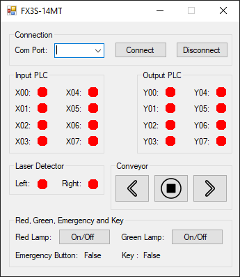

<h1 align="center">PLC_FX</h1>

<p align="center">
  <b>Mitsubishi FX3S-14MT</b> PLC'ni serial (programming port) orqali kuzatish va boshqarish uchun
  kichik va qulay <b>Windows</b> dasturi. C# va WinForms'da yozilgan.
</p>

<p align="center">
  <a href="README.md">English</a> · <b>O'zbekcha</b>
</p>



## Dastur nima qiladi

PLC_FX Mitsubishi FX3S-14MT'ga serial programming port orqali ulanadi va jonli boshqaruv
paneli beradi:

- **Jonli I/O monitor.** Sakkizta kirish (`X00`–`X07`) va oltita chiqish (`Y00`–`Y05`) yumaloq
  indikator sifatida ko'rsatiladi: yoniq bo'lsa **yashil**, o'chiq bo'lsa **qizil**.
- **Lazer datchiklari.** Chap/o'ng nurli to'siqlar holati (nur uzilganda qizil yonadi).
- **Konveyer boshqaruvi.** Chapga, o'ngga yoki to'xtatish.
- **Lampalar.** Qizil lampa, hamda yashil lampa + sovutgich (birgalikda).
- **Xavfsizlik holati.** Avariya tugmasi (emergency) va kalit (key) holati to'g'ridan-to'g'ri
  PLC'dan o'qiladi.
- **Oddiy serial sozlama.** COM portni tanlang, **Connect** bosing — dastur PLC'ni fonda
  so'rab turadi va oyna qotib qolmaydi.

Dastur ochiq kodli [HslCommunication](https://github.com/dathlin/HslCommunication) kutubxonasiga
asoslanadi (Mitsubishi FX serial protokolini biladi).

## Qanday ishlaydi

```
┌─────────────┐    RS-422 / USB-serial    ┌──────────────────┐
│   PLC_FX    │ ◀───── 9600 7E1 ─────────▶ │  FX3S-14MT PLC   │
│  (WinForms) │     MELSEC FX protokoli    │  X00–X07 kirish  │
└─────────────┘                            │  Y00–Y05 chiqish │
                                           └──────────────────┘
```

Fon oqimi (thread) PLC'ni har ~100 ms'da so'raydi va natijani UI oqimiga uzatadi — shu sababli
oyna javobgar bo'lib turadi va serial liniya ortiqcha yuklanmaydi.

### I/O jadvali

| Manzil  | Vazifasi                     | Qayerda ko'rinadi        |
|---------|------------------------------|--------------------------|
| `X00`   | Kalit (key)                  | **Key** holati           |
| `X03`   | Avariya tugmasi (NC)         | **Emergency Button** holati |
| `X04`   | Chap lazer datchik           | **Laser · Left**         |
| `X05`   | O'ng lazer datchik           | **Laser · Right**        |
| `X01`,`X02`,`X06`,`X07` | Umumiy kirishlar | Kirish indikatorlari     |
| `Y00`   | Yashil lampa                 | **Green Lamp** tugmasi   |
| `Y04`   | Sovutgich (cooler)           | yashil lampa bilan birga |
| `Y01`,`Y02`,`Y03`,`Y05` | Umumiy chiqishlar | Chiqish indikatorlari |
| `M16`   | Konveyer **chapga**          | **◀** tugma              |
| `M32`   | Konveyer **o'ngga**          | **▶** tugma              |
| `M48`   | Qizil lampa                  | **Red Lamp** tugmasi     |

**Stop** (■) tugmasi `M16` va `M32` ni o'chiradi.

## Talablar

- **Windows 10/11**
- **[.NET Framework 4.7.2](https://dotnet.microsoft.com/download/dotnet-framework/net472)** (zamonaviy Windows'da o'rnatilgan bo'ladi)
- **Mitsubishi FX3S-14MT** PLC va serial / USB-to-serial kabel
- Yig'ish uchun [Visual Studio 2019/2022](https://visualstudio.microsoft.com/) (*.NET desktop development*)

### Serial sozlamalar

Dastur FX programming port'ning qat'iy parametrlarini ishlatadi, hech narsa sozlamaysiz:

| Sozlama    | Qiymat |
|------------|--------|
| Baud rate  | 9600   |
| Data bits  | 7      |
| Parity     | Even   |
| Stop bits  | 1      |

## Yig'ish va ishga tushirish

```bash
git clone https://github.com/shaxboz1011/C-and-Mitsubishi.git
cd C-and-Mitsubishi
```

**`PLC_FX.sln`** ni Visual Studio'da oching va **F5** bosing, yoki *Developer Command Prompt*'dan:

```bat
nuget restore PLC_FX.sln
msbuild PLC_FX.sln /p:Configuration=Release
PLC_FX\bin\Release\PLC_FX.exe
```

NuGet ikkita kutubxonani o'zi tiklaydi: **HslCommunication** va **Newtonsoft.Json**.

## Foydalanish

1. Kabelni ulang va PLC'ni yoqing.
2. Dasturni oching, **COM Port** ni tanlang va **Connect** bosing.
3. Indikatorlar jonlanadi. **Conveyor**, **Lamp** va boshqa tugmalar bilan chiqishlarni boshqaring.
4. **Disconnect** bosing (yoki oynani yoping) — port bo'shaydi.

## Muammolarni hal qilish

| Muammo | Yechim |
|--------|--------|
| COM Port ro'yxati bo'sh | Kabelni ulang va dasturni qayta oching; Device Manager'dan portni tekshiring. |
| "Could not open COMx" | Portni boshqa dastur (masalan GX Works) band qilgan yoki noto'g'ri port tanlangan. |
| Ulandi, lekin yangilanmayapti | Kabel ulanishini va PLC RUN rejimida ekanini tekshiring. |

## Hissa qo'shish

Issue va pull request'lar mamnuniyat bilan qabul qilinadi — [CONTRIBUTING.md](CONTRIBUTING.md).

## Litsenziya

[MIT](LICENSE) © shaxboz1011 va hissa qo'shuvchilar
